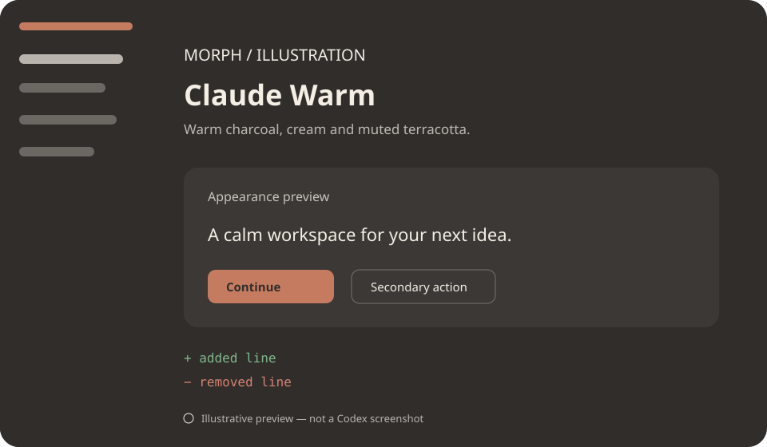
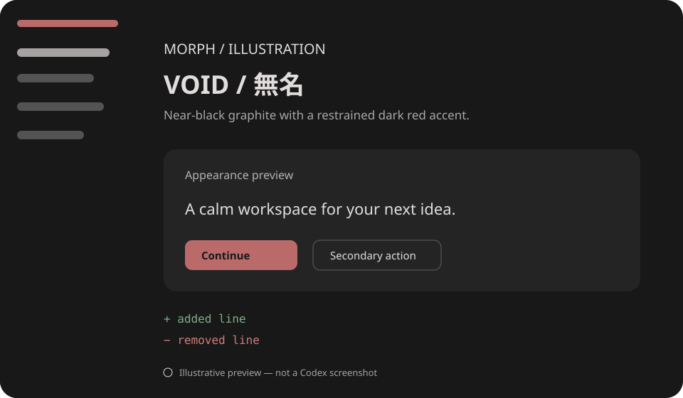

<div align="center">

# MORPH
### Shape your Codex.

**Choose a look. Copy its theme. Apply it through Codex Desktop when your build supports import.**

[Themes](#theme-gallery) · [One-minute setup](#quick-start) · [PowerShell](#powershell) · [Compatibility](#compatibility)

</div>

Morph is a lightweight, open-source theme gallery and toolkit for Codex Desktop. Theme imports use a community-observed format and are **not verified against your installed build**. Morph never patches the app or edits its settings.

## Quick Start

### Option A · No installation

1. Choose Claude Warm or VOID below and open its `.codex-theme-v1` artifact.
2. Copy the entire single line beginning with `codex-theme-v1:`.
3. In Codex Desktop, open **Settings → Appearance** and select **Import** for the dark theme, if that control is available.
4. Paste the line, inspect the preview, then apply it only if it looks right.

If there is no Import control or Codex rejects the line, your build is unsupported by this workflow. Keep your current appearance. Compatibility is unverified.

### Option B · Ask Codex

Copy [`prompts/install-theme.md`](prompts/install-theme.md) into Codex. It will help you choose a theme, check the documented limits, locate the import artifact, and explain the manual steps. You do not need Git, PowerShell, or knowledge of JSON.

### Option C · PowerShell

Requires PowerShell 7.4 or newer. Clone the repository, then run:

```powershell
./scripts/Morph.ps1 help
./scripts/Morph.ps1 list
./scripts/Morph.ps1 show claude-warm
./scripts/Morph.ps1 export claude-warm
```

## Theme Gallery

Preview illustrations use the exact colors in each profile. They are generated SVGs, **not screenshots of Codex Desktop**.

### Claude Warm

Warm charcoal, soft cream text, and muted terracotta accents.



[Open the copyable import artifact](themes/claude-warm.codex-theme-v1)

Palette: surface `#302d2b` · text `#f4eee5` · accent `#c57b60` · added `#81b88b` · removed `#d68272`.

### VOID / 無名

Near-black graphite surfaces with restrained red accents and minimal visual noise.



[Open the copyable import artifact](themes/void.codex-theme-v1)

Palette: surface `#181819` · text `#e2dddd` · accent `#bb6a6a` · added `#80ad88` · removed `#d17b79`.

Both profiles use the built-in `one` code theme ID and target the dark variant. The artifact format is community-observed. Import success is not guaranteed.

## PowerShell

```powershell
./scripts/Morph.ps1 help
./scripts/Morph.ps1 list
./scripts/Morph.ps1 show void
./scripts/Morph.ps1 check
./scripts/Morph.ps1 export void
./scripts/Morph.ps1 export void -Path ./void.txt -WhatIf
./scripts/Morph.ps1 backup -Path ./settings.json -WhatIf
./scripts/Morph.ps1 restore -Path ./settings.json.morph-backup -BackupPath ./settings-restored.json -WhatIf
./scripts/Morph.ps1 diagnostics
```

`export` prints a one-line import artifact; with `-Path`, it writes only to a new destination and refuses to overwrite. `backup` and `restore` work only on explicit file paths. Restore writes to a new destination and refuses overwrite. Modifying commands support `-WhatIf`.

## Compatibility

OpenAI’s public documentation describes Codex Desktop appearance options for themes, colors, and UI/code fonts, and the CLI has its own `.tmTheme` format. It does not document the `codex-theme-v1:` payload schema or guarantee import compatibility. Morph has not verified a successful import on this machine because no Codex Desktop window was available during development.

Treat the included artifacts as experimental. Use them only if your app visibly offers Import and shows a preview. If import is absent or rejected, stop. Sidebar placement, panel arrangements, density, and custom layouts remain planned; Morph does not use unsupported app modifications.

## Features

- Plain JSON theme profiles validated against a closed schema.
- Deterministic import artifact and preview generation.
- PowerShell commands for listing, inspection, validation, export, diagnostics, and explicit file backup/restore.
- No telemetry, downloads, credential or conversation access, background service, application patching, or settings edits.

## Roadmap

1. Verify import artifacts against supported Codex Desktop builds and publish a tested compatibility matrix.
2. Add reviewed light variants and accessibility checks.
3. Investigate supported layout options.
4. Consider a separate Codex CLI adapter for `.tmTheme` files.

## Contributing

See [`CONTRIBUTING.md`](CONTRIBUTING.md). New profiles must use the schema and must not include executable content or undocumented application settings.

## License

MIT. See [`LICENSE`](LICENSE).
