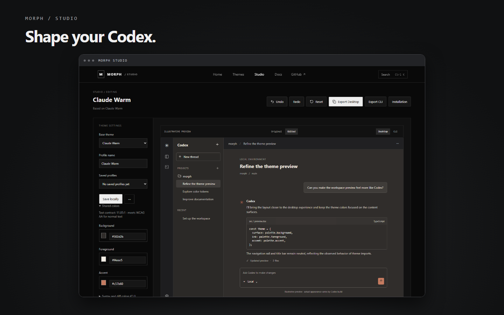
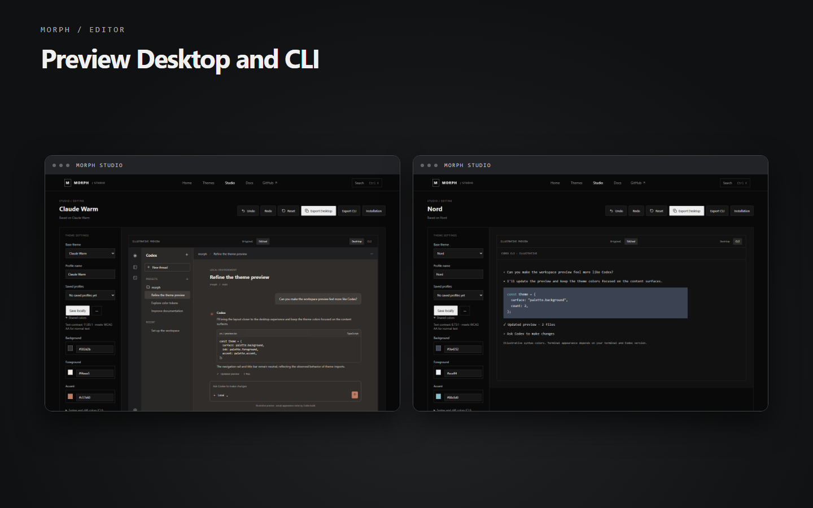
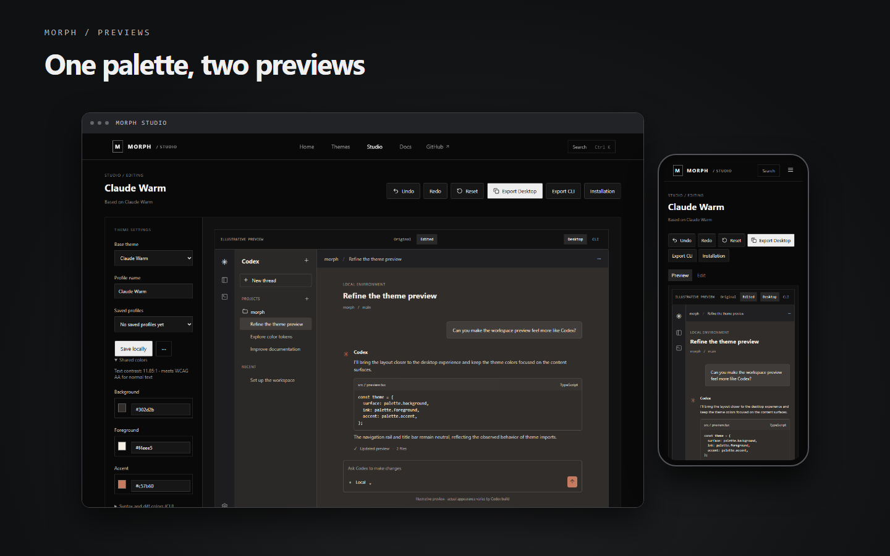
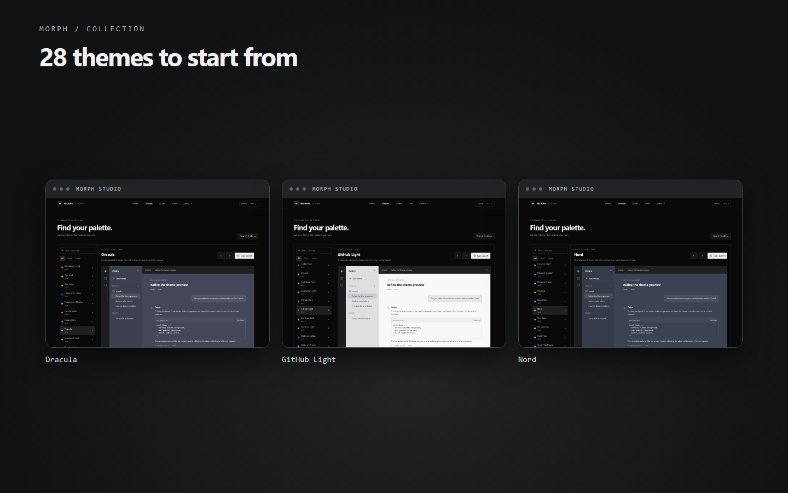

<div align="center">

# MORPH

**Shape your Codex.**

Explore 28 themes, refine a palette, and export it for Codex Desktop and CLI.

[Open Morph Studio](https://nonamelx.github.io/morph/) · [Windows CLI tutorial](docs/windows-cli-theme.md)

</div>



Morph Studio brings a theme collection, switchable target previews, a color editor, and local profiles into one workspace. Codex provides its own theme settings and CLI picker. Morph helps you browse, customize, and export a palette for those separate workflows.

[Quick start](#quick-start) · [Theme gallery](#theme-gallery) · [Studio and profiles](#studio-and-profiles) · [Development](#development) · [Compatibility](docs/compatibility.md)

## Quick start

### Codex CLI on Windows

[Follow the Windows CLI tutorial](docs/windows-cli-theme.md) to edit a palette in Studio, install the exported TextMate file, and select it in `/theme`.

### Codex Desktop

For a Desktop theme without installing Studio:

1. Choose a theme in the [gallery](#theme-gallery) and open **Import theme**.
2. Copy the full line beginning `codex-theme-v1:`.
3. In Codex Desktop, open **Settings → Appearance** and choose **Import** in the matching light or dark section.
4. Paste the line, review the preview, and confirm.

If your build has no Import control or rejects the string, consult the [compatibility notes](docs/compatibility.md). The JSON schema describes Morph source files and is not an import file.

## Studio and profiles

Open [Studio](https://nonamelx.github.io/morph/#studio), [Themes](https://nonamelx.github.io/morph/#themes), or [Docs](https://nonamelx.github.io/morph/#docs). To run Studio locally, use Node.js and npm:

```powershell
cd web
npm ci
npm run dev
```

Open the local URL printed by Vite. Use **Themes** to browse, **Studio** to edit, and **Docs** for the in-app guide. Studio provides Desktop and CLI previews, Original and Edited comparison, color controls, contrast feedback, undo, redo, and reset. Previews are illustrative and actual rendering depends on the Codex build and terminal.

With the default local server running, open [Studio](http://127.0.0.1:5173/morph/#studio), [Themes](http://127.0.0.1:5173/morph/#themes), or [Docs](http://127.0.0.1:5173/morph/#docs). If Vite chooses another port, use the URL it prints with the same fragment.



In Studio, choose a base theme, adjust colors, then use **Export Desktop** or **Export CLI**. Use **Save locally** for a browser-local profile. The profile actions menu offers duplicate, rename, delete, and JSON import/export. Profiles live in that browser's local storage, so export JSON before clearing browser data or moving to another device. Imported profiles are validated and treated as data.

## Desktop and CLI compatibility

Desktop and CLI use different formats. Desktop uses the community-derived `codex-theme-v1:` import string. A user reported one successful Windows Desktop import, with the main background, chat sidebar, and accents changing while the far-left navigation rail and top bar stayed unchanged. The build and restart persistence were not recorded.

CLI export produces a TextMate `.tmTheme` file for syntax highlighting. Codex CLI v0.167.2 on Windows discovered and selected a generated theme in `/theme`; color rendering was not visually verified. The terminal and Codex control other interface colors. See the [compatibility notes](docs/compatibility.md) and [OpenAI CLI customization guide](https://learn.chatgpt.com/docs/cli-customization).

To install a CLI export:

1. Download the `.tmTheme` file from Studio.
2. Put it in `$CODEX_HOME/themes`. If `CODEX_HOME` is unset, this is normally `~/.codex/themes` or `%USERPROFILE%\.codex\themes` on Windows. Create the directory if needed.
3. Start Codex CLI, run `/theme`, and select the filename without `.tmTheme`.

Morph exports files and import strings without changing Codex settings or application bundles. It does not provide layout, panel placement, or full application chrome theming.



[View the mobile Preview and Edit showcase](docs/assets/hero-mobile.png) · [Browse the original browser captures](artifacts/screenshots/release)

## Theme gallery

Preview images are generated from the source colors. They are illustrative theme previews, not screenshots of Codex Desktop.



| Theme | Mode | Preview | Import | Theme attribution |
| --- | --- | --- | --- | --- |
| Absolutely Light | light | [absolutely-light/preview.svg](themes/absolutely-light/preview.svg) | [**Import theme**](themes/absolutely-light/import.txt) | OpenAI / Codex Themes |
| Ayu Dark | dark | [ayu-dark/preview.svg](themes/ayu-dark/preview.svg) | [**Import theme**](themes/ayu-dark/import.txt) | teabyii / Codex Themes |
| Ayu Light | light | [ayu-light/preview.svg](themes/ayu-light/preview.svg) | [**Import theme**](themes/ayu-light/import.txt) | teabyii / Codex Themes |
| Catppuccin Latte | light | [catppuccin-latte/preview.svg](themes/catppuccin-latte/preview.svg) | [**Import theme**](themes/catppuccin-latte/import.txt) | Catppuccin / Codex Themes |
| Catppuccin Mocha | dark | [catppuccin-mocha/preview.svg](themes/catppuccin-mocha/preview.svg) | [**Import theme**](themes/catppuccin-mocha/import.txt) | Catppuccin / Codex Themes |
| Claude Warm | dark | [claude-warm/preview.svg](themes/claude-warm/preview.svg) | [**Import theme**](themes/claude-warm/import.txt) | Morph (independent adaptation) |
| Codex Dark | dark | [codex-dark/preview.svg](themes/codex-dark/preview.svg) | [**Import theme**](themes/codex-dark/import.txt) | OpenAI / Codex Themes |
| Dracula | dark | [dracula/preview.svg](themes/dracula/preview.svg) | [**Import theme**](themes/dracula/import.txt) | Dracula Theme / Codex Themes |
| Everforest Dark | dark | [everforest-dark/preview.svg](themes/everforest-dark/preview.svg) | [**Import theme**](themes/everforest-dark/import.txt) | sainnhe / Codex Themes |
| Everforest Light | light | [everforest-light/preview.svg](themes/everforest-light/preview.svg) | [**Import theme**](themes/everforest-light/import.txt) | sainnhe / Codex Themes |
| GitHub Dark | dark | [github-dark/preview.svg](themes/github-dark/preview.svg) | [**Import theme**](themes/github-dark/import.txt) | GitHub / Codex Themes |
| GitHub Light | light | [github-light/preview.svg](themes/github-light/preview.svg) | [**Import theme**](themes/github-light/import.txt) | GitHub / Codex Themes |
| Gruvbox Dark | dark | [gruvbox-dark/preview.svg](themes/gruvbox-dark/preview.svg) | [**Import theme**](themes/gruvbox-dark/import.txt) | morhetz / Codex Themes |
| Gruvbox Light | light | [gruvbox-light/preview.svg](themes/gruvbox-light/preview.svg) | [**Import theme**](themes/gruvbox-light/import.txt) | morhetz / Codex Themes |
| Material Lighter | light | [material-lighter/preview.svg](themes/material-lighter/preview.svg) | [**Import theme**](themes/material-lighter/import.txt) | material-theme / Codex Themes |
| Material Ocean | dark | [material-ocean/preview.svg](themes/material-ocean/preview.svg) | [**Import theme**](themes/material-ocean/import.txt) | material-theme / Codex Themes |
| Monokai | dark | [monokai/preview.svg](themes/monokai/preview.svg) | [**Import theme**](themes/monokai/import.txt) | Wimer Hazenberg / Codex Themes |
| Night Owl | dark | [night-owl/preview.svg](themes/night-owl/preview.svg) | [**Import theme**](themes/night-owl/import.txt) | Sarah Drasner / Codex Themes |
| Nord | dark | [nord/preview.svg](themes/nord/preview.svg) | [**Import theme**](themes/nord/import.txt) | arcticicestudio / Codex Themes |
| One Dark | dark | [one-dark/preview.svg](themes/one-dark/preview.svg) | [**Import theme**](themes/one-dark/import.txt) | Atom / Codex Themes |
| Poimandres | dark | [poimandres/preview.svg](themes/poimandres/preview.svg) | [**Import theme**](themes/poimandres/import.txt) | poimandres / Codex Themes |
| Rosé Pine | dark | [rose-pine/preview.svg](themes/rose-pine/preview.svg) | [**Import theme**](themes/rose-pine/import.txt) | rose-pine / Codex Themes |
| Rosé Pine Dawn | light | [rose-pine-dawn/preview.svg](themes/rose-pine-dawn/preview.svg) | [**Import theme**](themes/rose-pine-dawn/import.txt) | rose-pine / Codex Themes |
| Solarized Dark | dark | [solarized-dark/preview.svg](themes/solarized-dark/preview.svg) | [**Import theme**](themes/solarized-dark/import.txt) | Ethan Schoonover / Codex Themes |
| Solarized Light | light | [solarized-light/preview.svg](themes/solarized-light/preview.svg) | [**Import theme**](themes/solarized-light/import.txt) | Ethan Schoonover / Codex Themes |
| Tokyo Day | light | [tokyo-day/preview.svg](themes/tokyo-day/preview.svg) | [**Import theme**](themes/tokyo-day/import.txt) | enkia / Codex Themes |
| Tokyo Night | dark | [tokyo-night/preview.svg](themes/tokyo-night/preview.svg) | [**Import theme**](themes/tokyo-night/import.txt) | enkia / Codex Themes |
| VOID / 無名 | dark | [void/preview.svg](themes/void/preview.svg) | [**Import theme**](themes/void/import.txt) | Morph (original) |

The collection contains **28 themes**: 26 adapted from [shaw-baobao/codex-themes](https://github.com/shaw-baobao/codex-themes), plus Morph’s Claude Warm and VOID / 無名. Per-theme source files retain author attribution. See [THIRD_PARTY_NOTICES.md](THIRD_PARTY_NOTICES.md) for licensing and provenance.


## Development

Requirements are PowerShell 7.4 or newer for Morph scripts and Node.js with npm for Studio. From the repository root:

```powershell
./scripts/Morph.ps1 help
./scripts/Morph.ps1 list
./scripts/Morph.ps1 export nord
./tools/Build-Themes.ps1 -Check
./tests/Run-Tests.ps1
```

For the website:

```powershell
cd web
npm ci
npm run dev
npm run lint
npm test
npx playwright install chromium
npm run test:ui
npm run build
```

Edit `themes/<slug>/theme.json` as the source of truth. Run `./tools/Build-Themes.ps1` after editing to validate sources and regenerate import strings, previews, and the catalog. The PowerShell CLI also provides `show`, `preview`, `check`, `diagnostics`, and explicit file `backup` and `restore` operations.

## Troubleshooting

- **Desktop rejects an import:** copy the entire `import.txt` line and use the matching light or dark section. Import availability and accepted fields vary by build.
- **CLI theme is missing:** check the file extension and the active `$CODEX_HOME/themes` directory, then restart the CLI and open `/theme`.
- **A local profile is missing:** use the same browser and origin where it was saved. Browser storage can be cleared. Import a previously exported profile JSON to restore it.
- **Clipboard access fails:** use the selectable Desktop import text in Studio's import/export details.

Morph does not use a backend, telemetry, credentials, or account data. It validates profile imports and does not execute their contents. Report security concerns using [SECURITY.md](SECURITY.md).

## Contributing and license

See [CONTRIBUTING.md](CONTRIBUTING.md) for source and test guidance. Morph is licensed under [MIT](LICENSE). Theme authors, source URLs, and applicable license terms are recorded in [THIRD_PARTY_NOTICES.md](THIRD_PARTY_NOTICES.md).
