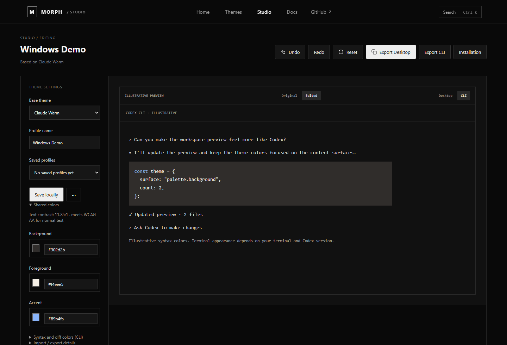

# Customize a Codex CLI theme on Windows

Use Morph Studio to edit a palette in your browser, then install the exported TextMate theme in Codex CLI. This walkthrough was verified on Windows 11 with Codex CLI v0.167.2.

## 1. Customize and export

1. Open [Morph Studio](https://nonamelx.github.io/morph/#studio) and choose a **Base theme**.
2. Set **Profile name** to `Windows Demo`. Under **Shared colors**, set the Accent HEX field to `#89b4fa` and press Tab to apply it.
3. Select **CLI** in the preview. Use **Original** and **Edited** to compare the palettes.
4. Select **Export CLI**. The browser downloads `windows-demo.tmTheme`.



## 2. Copy the theme into Codex's themes folder

In PowerShell, paste the following block. When prompted, enter the full path to the downloaded file. In File Explorer, **Copy as path** gives you the full path.

```powershell
$sourcePath = (Read-Host 'Path to the downloaded .tmTheme file').Trim('"')
$source = Get-Item -LiteralPath $sourcePath -ErrorAction Stop
if ($source.PSIsContainer -or $source.Extension -ine '.tmTheme') {
    throw 'Choose the downloaded .tmTheme file.'
}

$codexDirectory = if ($env:CODEX_HOME) {
    $env:CODEX_HOME
} else {
    Join-Path ([Environment]::GetFolderPath('UserProfile')) '.codex'
}
$themeDirectory = Join-Path $codexDirectory 'themes'
New-Item -ItemType Directory -Path $themeDirectory -Force | Out-Null
$destination = Join-Path $themeDirectory $source.Name
if (Test-Path -LiteralPath $destination) {
    throw "A theme already exists at $destination. Rename your download and try again."
}
Copy-Item -LiteralPath $source.FullName -Destination $destination -ErrorAction Stop
```

## 3. Select it in Codex CLI

1. Exit any running Codex CLI session and run `codex` again from the same PowerShell window. This uses the same `CODEX_HOME` as the copy step.
2. Type `/theme` and press Enter to open **Select Syntax Theme**.
3. Type `windows-demo` to filter the list, select **windows-demo (custom)**, and press Enter. If you renamed the file, search for its filename without the extension. Codex saves the selected name in `tui.theme` in its `config.toml`.

If the theme is missing, confirm the file ends in `.tmTheme` and is inside the active Codex home’s `themes` folder, then start a fresh CLI session.

The theme applies to syntax highlighting for code and diffs in the terminal UI. Your terminal controls its own palette and window appearance. For Desktop imports, see the [compatibility notes](compatibility.md). [OpenAI Docs on CLI customization](https://learn.chatgpt.com/docs/cli-customization)
